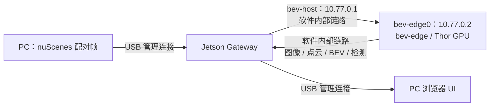

# Thor Fusion Observatory

实际运行在 Jetson Thor 上的六路摄像头＋激光雷达融合演示。PC 或 Jetson 本机提供数据回放和浏览器 UI；Jetson 完成 TensorRT 视觉检测、CUDA 标定投影、BEV 占用计算、视觉与雷达关联以及车辆位姿对齐的局部累积建图。

浏览器入口：**http://127.0.0.1:8088**。Jetson 管理地址：`192.168.55.18`，PC USB 地址：`192.168.55.100`。

2026-10-13 调试：已从 `ttyACM0` 登录、确认 SSH 开机启用，并配置当前 PC 的密钥登录别名 `jetson-bev`。`ssh jetson-bev` 同时转发 Jetson 的本地界面到 PC **http://127.0.0.1:18088**。PC 模式现在默认暂停，Jetson 本地模式默认 20 FPS，避免两个回放源同时自动送帧。

“车道线鸟瞰”现在使用 **道路／车道线分割掩码＋物体填充轮廓**，替代相机纹理拼接。六路相机运行 MIT YOLOP 分割网络，经标定投影生成蓝灰色道路、浅黄色标线；YOLO26n 与 LiDAR 关联提供彩色物体轮廓。每个地面栅格按视角权重融合可见相机，排除物体遮挡，限制为 25 m 投影距离。道路保留最多 6 秒经 ego pose 对齐的实际观测，短暂遮挡和近车盲区可被近期观测补全；标线颜色只保留 0.3 秒，较旧标线观测转为道路底色，防止累积拖影。只在可见区域闭合约 0.4 m 内的小孔；未曾观测、过期或有强烈非道路证据的区域不补画。车辆与行人不进入历史。显示范围仍是 60 m × 60 m。模型在 BDD100K 训练，nuScenes 的分割精度尚未评估；仍采用局部平面假设，坡道与未识别遮挡可能影响几何对齐。

2026-10-13 当前版本已部署，目标机 **22 项检查及 579 帧全部通过**。软件内部链路下单一回放源验证：流水线中位 55.92 ms，六路目标检测 CUDA 中位 4.11 ms，六路路面分割 CUDA 中位 21.60 ms，PC HTTP 往返中位 92.71 ms。与此前逐帧掩码版本对比，同一批 579 帧的道路／标线平均显示像素从 65,752 增至 130,164（约 1.98 倍），三个场景首帧均无历史填充。这表示显示覆盖改善，不代表分割精度提升。证据：`logs/validation-continuity-20261013.json`、`logs/continuity-comparison-20261013.json`，前后对比：`logs/bev-continuity-comparison.jpg`。

2026-10-14 已部署默认「鸟瞰＋3D 对比」：同一后端帧的语义鸟瞰与点云在两侧同步显示、独立操作，窄屏上下排列。全屏会压缩页头、指标和导航，把剩余高度用于对比窗口；页面取消 1920px 宽度上限，支持 4K，Esc 或全屏按钮恢复普通布局。浏览器不允许原生全屏时仍启用放大的页面布局。「融合 BEV」更名「几何融合 BEV」，「累积建图」更名「位姿累积图」，并显示后端占用格数、关联点数、累积帧数及计算耗时。目标机 22 项检查再次通过；独立后端核查通过：相同输入复现相同输出，移除雷达使空间目标 6 → 0 且占用归零；27 个连续帧与独立 CPU 几何参考吻合，历史上限 25 帧，重置使地图占用 29,504 → 3,713 格。证据：`logs/backend-audit-20261014.json`、`logs/comparison-tests-20261014.txt`。它们是实际后端计算的几何基线，当前未运行 BEVFusion 特征融合网络或自主定位 SLAM。

nano 配置已恢复。用户报告短接万兆口时死机，因此默认改为 **USB 管理＋软件内部 veth 链路**；`mgbe2_0`、`mgbe3_0` 默认关闭。物理回环的底层问题尚未定位，当前不能归因于 medium 模型。一次道路引擎构建期间也遇到重启，是否与插线或人为重启有关尚待确认；重启后以 optimization level 0 构建成功并通过上述验证。已启用 128 MiB 有界的持久 kernel journal，并保存 PC 端内核流日志。此前现有 medium 引擎仍未取得完整运行验证，不作为默认演示引擎。

## Jetson 本地启动与查看

`start-local.sh` 在 Jetson 上启动 GPU 后端、本机数据回放和 Web 前端，并从 Jetson 桌面打开浏览器。管理 Gateway 走本机 `127.0.0.1:9000`；相机/雷达算法输入及结果经过 Jetson 内部软件链路；当前不需要短接万兆网口。运行时不需要连接 PC，也不需要外网。

PC 已生成离线包 `dist/jetson-bev-local.tar.gz`，包含前后端源码、离线 Three.js、579 帧 NPZ 数据包和 ONNX 模型。把它拷贝到 Jetson 的 `/home/seeed/`，在 Jetson 桌面终端执行：

```bash
cd /home/seeed
tar -xzf jetson-bev-local.tar.gz
cd jetson-bev-demo
bash start-local.sh
```

脚本使用这台 Jetson 已有的 `.venv` 和目标机 TensorRT engine，解压不会覆盖它们，也不打包 PC 的 Python 环境或其它设备的 engine。脚本先检查依赖与数据，再验证真实六路首帧；成功后打开 **http://127.0.0.1:8088/**。后端及 UI 由 systemd 管理，关闭终端后继续运行。启动时 sudo 只用于服务配置与后端启动；以 `seeed` 普通用户运行整个脚本。已运行的实体网络服务不会被重启。

本地版本已同步并在 Jetson 上实际启动验证，前端、数据、GPU 算法及离线 Three.js 均已安装。已修复网口服务启动时早于 NetworkManager 的顺序问题。Firefox 安装完成，Jetson 本地屏幕已显示真实 3D 点云和检测结果。首帧启动日志见 `logs/jetson-local-start.txt`；随后在实体 9.5 Gbps 输入压测下，579 帧全部通过数值和输出检查，流水线中位耗时 89.06 ms、CUDA 推理中位耗时 7.94 ms，MAC 输入均值 9.662 Gbps，NVML 窗口利用率采样均值 13.3%。记录见 `logs/validation-gpu-long.json`。这些测量包含当时的压测和浏览器安装活动，不能直接与独立算法对比测试等同。

```bash
# 默认无附加压测，使用软件内部链路
bash start-local.sh --engine yolo26n-thor-b6.engine

# 选择已验证的六路 nano 引擎，或显式选择较大的引擎
bash start-local.sh --engine yolo26n-thor-b6.engine
# 现有 medium engine 已复现首帧期间失联，需重建和独立验证后使用

# 无桌面会话时只启动服务，然后在 Jetson 浏览器手动打开上述地址
bash start-local.sh --no-browser
bash start-local.sh status
bash start-local.sh stop

# 查看运行日志
journalctl --user -u jetson-bev-local-ui -f
sudo journalctl -u jetson-bev-worker -f
```

道路分割引擎在首次安装时需在目标机构建：

```bash
LD_LIBRARY_PATH=/usr/local/cuda/lib64 .venv/bin/python jetson/build_engine.py --model models/yolop-road-b6.onnx --output models/yolop-road-thor-b6.engine --aux-streams 0 --optimization-level 0
```

默认 `--engine auto` 使用已验证的 YOLO26n 六路引擎，默认目标回放 FPS 为 20，UI 显示实际完成速率。现有 YOLO26m 引擎在首帧期间复现目标机失联；需重建和排查后再验证，当前使用 nano。`stop` 停止本地前端和回放，保留后端与实体网口配置。PC 与 Jetson 本地回放应选择一处启动，避免同时更新同一个算法地图。可在 PC 重新生成离线包：`python3 tools/pack_local.py`。

## 网络和计算路径



此前曾验证 **两个实体万兆网口回环**（当前已停用）：`mgbe2_0` 位于宿主网络空间，`mgbe3_0` 位于 `bev-edge`，两端均协商 10,000 Mbps、全双工。不同网络空间确保数据实际经过网线；当时软件接口/路由已停用。此前相机与雷达输入、GPU 结果和压测经过实体链路；当前使用 bev-host ⇄ bev-edge0 软件链路。PC 经 USB 做数据回放、管理和 UI 传输。

此前两端请求 MTU 9000；当时 NVIDIA 驱动实际报告 MTU **8966**，已用不允许分片的 8900 字节 ICMP 数据验证。当时只调整这两个测试端口的 MTU，并将其八个队列中断分配到 CPU 2–9；未修改 BSP、CUDA/TensorRT 或当前功耗模式。切回软件链路时已恢复原中断亲和性、MTU，归还 `mgbe3_0`。

**速率读取 MAC 硬件 MMC octet counters。** 此版 nvethernet 的 Linux `tx_bytes` 在 TSO/端口重启后会产生异常值，已改用 `ethtool -S` 的硬件计数，与对端 RX 及 iperf3 交叉验证；原始 Linux 数值仍保留在诊断 API 的 `kernel_tx_bytes`。主面板 TX/input 是 `mgbe2_0` 的发送，RX/output 是其接收；单独选择网口时显示该口实际 RX/TX。全双工利用率按较忙方向除以 10 Gbps 计算。

附加压测使用四条 iperf3 TCP 流，可选单向输入、单向输出或同时双向，速率选项为 1/3/6/9/9.5 Gbps。它与传感器/算法流量在 UI 中分别说明；传感器数据本身没有被伪装成万兆吞吐。软件千兆模式仍作为可选后备：先在 `deploy/network.env` 仍存在时停止 gateway、worker 和 net 服务，完成实体端口恢复；再将该环境文件移走并重启三个服务，即可使用原 `10.77.0.0/30` 链路。

## 数据与算法

- 从 [nuScenes mini 官方数据](https://www.nuscenes.org/data/v1.0-mini.tgz) 流式选取三个完整场景的 **579 个配对帧**：`scene-0061` 186 帧、`scene-0103` 193 帧、`scene-0553` 200 帧。从关键帧及原始 sweeps 中按约 10 Hz 选择 LiDAR，并为每个雷达帧选择时间最近的六路相机影像；每路时间差不超过 80 ms，使用各自的采集位姿进行补偿。保留 4018 个独立传感器文件，约 873.5 MB；加上推理数据包，目录共约 1.7 GiB。没有保留完整压缩包，也没有下载 trainval 全量数据。
- 三个场景合计原始时间约 58.55 秒；一轮播放时长由 UI 显示的实际处理 FPS 决定。每个场景内部连续回放；跨场景、跳帧和循环回到开头会重置跟踪与累计地图。
- 数据包在 PC 组装；PC 模式从 USB 回放，Jetson 本地模式从离线包中的本机数据目录回放。包使用无 pickle 的 NPZ；文件 SHA256 在 `data/nuscenes-long/manifest.json` 中。
- 摄像头按各自采集时间的 ego pose 变换到世界坐标，再投影回本帧 LiDAR 坐标，避免忽略多传感器采集时差。
- GPU 版本通过 nvJPEG 将六路 JPEG 解码到 GPU 内存；CUDA 完成缩放、letterbox、BGR→RGB、NCHW 与归一化，直接写入 TensorRT 输入缓冲区。GPU 完成检测筛选、坐标还原、点云投影、批量深度聚类、分位数空间框估计、BEV/地图栅格绘制、点云着色和 JPEG 输出，避免逐个检测框反复同步 CPU。Thor 现在优先使用 nvJPEG 硬件解码；不支持的格式回退 hybrid，此时部分解析/熵解码由 CPU 阶段执行；NPZ 解包、少量目标合并/跟踪、控制和 JSON/base64 封装仍在 CPU。
- 六路视觉组成单个 TensorRT FP16 batch。默认使用已验证的 `yolo26n-thor-b6.engine`（YOLO26n、640×640）。更大的 `yolo26m-thor-b6-960.engine` 需通过 `BEV_VISION_ENGINE` 或本地启动脚本的 `--engine` 显式选择，当前该现有文件在首帧期间复现失联，需重新构建并排查。显式指定文件不存在会报错；默认六路文件不存在时尝试已有单路 nano 引擎。运行状态以 worker `/health` 的 `vision_model` / `vision_resolution` 和 UI 为准。
- 2D 检测框与标定点云做深度聚类关联，估计类别、距离和轴对齐空间框；相邻帧做类别约束的近邻跟踪。
- 累积图用数据集提供的 ego pose 对齐最近 25 帧。它是局部占用建图，不是自主定位 SLAM。
- 不读 ground truth 生成预测。显示的目标置信度来自视觉检测；空间框是几何估计，没有假定检测精度或输出 mAP。

这是**视觉检测＋几何 BEV 融合基线**，不是原版预训练 BEVFusion 的 camera/lidar feature fusion 网络。两者的定位和性能不能等同。nuScenes 适用 CC BY-NC-SA 4.0；Ultralytics 代码/模型适用其 AGPL-3.0 条款；YOLOP 适用 MIT。

## UI

界面按数据类型分为三个选项卡：「传感器输入」显示放大的六路影像及可切换雷达投影；「融合与建图」默认同屏对比语义鸟瞰与 3D 点云，也可单独查看语义鸟瞰、3D 点云、几何融合 BEV 或位姿累积图，下面保留三个计算中间结果及空间目标列表；「网络与算力」显示实际网口速率、流量曲线、端口状态及 GPU/CPU/内存/温度/功耗。顶部指标、场景选择及同步回放控制在所有选项卡共用。左侧导航与选项卡同步；选项卡支持左右方向键、Home/End，浏览器保存最后选择。右上角可即时切换中文 / English，并保存语言偏好。切换界面视图不会停止后台数据回放或网口压测。

3D 画面已左右镜像，与鸟瞰显示方向对齐；检测标签位置随画面翻转、文字保持正常，水平拖动方向也已调整。验证截图：`logs/3d-mirror-20261014.jpg`。

以太网面板显示主数据链路的输入/输出速率，也独立显示 `mgbe0_0` 至 `mgbe3_0` 四个有线端口的 RX/TX、载波状态及协商速率。点击端口卡片或选择“监控接口”可查看该端口的曲线、累计字节和利用率。未接线或端口未启用时显示“未连接”及 0 Mbps；未取得的协商速率显示 `—`。UI 主标题使用 Ethernet，链路详情明确显示当前软件或实体链路与计数来源。USB 管理接口不算作这四个物理端口。

可以暂停、单帧前进、拖动场景进度、调整回放到 2/4/8/12/20 FPS、选择链路压测速率及方向和全屏展示。设置 FPS 是目标回放速率，面板 FPS 是实际完成速率。按空格切换播放，右方向键单帧前进；鼠标拖动旋转点云，滚轮缩放。所有平面 BEV 支持滚轮 1–8 倍缩放、拖动平移、双击复位；对比视图共享单独语义鸟瞰的缩放状态。对比模式的工具栏按钮复位左侧鸟瞰，右侧按钮复位点云，双击各自区域也可独立复位。接收新帧不会复位。

几何融合 BEV 将 CUDA 雷达高度／密度栅格与视觉检测经过雷达深度聚类、分位数框估计的结果叠加。位姿累积图使用 nuScenes 已给定的 ego pose 对齐最近 25 帧下采样点云，在重置首帧坐标系内重新计算占用，跨场景和跳转时清空；动态目标没有剔除，可能留痕。后端每帧返回 `fusion_bev`、`mapping` 元数据和 `mapping_ms`，供界面核对。暂停后核查两处回放的算法依赖、CPU 参考、历史上限及 reset，可运行 `python3 tools/audit_backend.py`；工具会在结束时恢复原回放状态。

流水线耗时可通过鼠标悬停底部 Jetson 节点查看；`vision_cuda_ms`、`preprocess_cuda_ms`、`postprocess_cuda_ms` 来自 CUDA events，其余阶段按壁钟计时。首次 CUDA/JIT 预热时间不用于性能对比。GPU 利用率通过持续 NVML 会话每 100 ms 读取，面板明确显示最近 2 秒硬件样本均值（包含真实零值），保留一位小数；悬停百分比可查看最近读数及窗口峰值。算力面板同时显示六路推理的 CUDA event 耗时、实际模型/分辨率与 GPU 加速阶段。NVML 自身有硬件统计周期，每 100 ms 读取不表示硬件每 100 ms 生成新统计。轻量模型、CPU 解包/封装和传输间隙会造成低负载或短时 0%，利用率不能等同 GPU 算力利用效率。温度与 GPU 功耗来自 `tegrastats`；硬件读取失败、监控断连时显示 `—`。暂停后的利用率需等待 NVML 统计及滚动窗口更新再回到真实空闲值。

GPU 迁移验证：`logs/gpu-pipeline-comparison.json` 使用三个场景的 11 个代表帧、相同 YOLO26n 引擎和相同传感器包，对比 CPU/GPU 混合版本及新 GPU 版本。去除首帧预热后的中位耗时：总流水线 101.56 → 51.53 ms、视觉阶段 14.04 → 5.23 ms、点云关联 30.63 → 2.58 ms、渲染阶段 30.54 → 16.14 ms。解码阶段由 15.27 → 18.58 ms，nvJPEG 的六路短批次并未在此阶段单独取得加速。JPEG 解码与插值差异会使阈值附近的检测略有变化，未宣称逐位相同或 mAP 改善。Jetson 上 4 项 CUDA 数值测试通过，记录见 `logs/gpu-kernel-tests.txt`。GPU 版本已使用六路 YOLO26n 上线，579 帧通过目标机验证；YOLO26m 引擎构建完成，但其运行验证期间 USB 管理连接再次中断，尚未确认该模型的稳定运行，原因未确认。

## 启动与停止

PC 已配置用户服务，Jetson 配置了三个系统服务：

```bash
# PC
systemctl --user start jetson-bev-ui
systemctl --user stop jetson-bev-ui
systemctl --user status jetson-bev-ui

# Jetson
sudo systemctl start jetson-bev-net jetson-bev-worker jetson-bev-gateway
sudo systemctl stop jetson-bev-gateway jetson-bev-worker jetson-bev-net
sudo journalctl -u jetson-bev-worker -u jetson-bev-gateway -n 80
```

关闭 PC UI 服务会停止附加链路压测。停止 `jetson-bev-net` 会先恢复实体端口的原中断配置、归还移入 namespace 的端口、恢复原 MTU 及 NetworkManager 管理，再删除 demo 网络空间。应先停止 worker/gateway；恢复和重启时会短暂中断这两个测试网口。USB 地址由 NVIDIA 的 USB device-mode 持久配置保持为 `192.168.55.18`。

网络共享为运行时配置，当前保持 USB DHCP 和 PC 的其它连接配置。PC 重启后可重新开启；脚本交互询问密码，不存储凭据：

```bash
cd /other_data/jetson-bev-demo
/usr/bin/python3 tools/share_usb.py start
/usr/bin/python3 tools/share_usb.py stop
```

仅添加标识为 `jetson-bev-usb-share` 的目标专用转发/NAT 规则、Jetson 的 metric 100 默认路由及运行时 DNS。已有 NetworkManager `jetson-wired-share` 连接保留原样。

## 重新部署

本机已验证环境：JetPack 7.2 / L4T R39.2、Python 3.12、CUDA 13.2、TensorRT 10.16.2。技能原始兼容矩阵仅含 JP5/JP6，因此 `compatibility.json` 是 `needs-adjustments`；本项目通过独立 Python 环境和目标机 GPU/引擎实测验证 JP7.2，未更换系统 CUDA/TensorRT。

```bash
cd /other_data/jetson-bev-demo
npm ci
/usr/bin/python3 tools/download_data.py --root data/nuscenes-long --scenes 3 --frames 600 --sample-hz 10

# 模型导出只在 PC 需要 PyTorch/Ultralytics
python3 -m venv --system-site-packages .venv-export
.venv-export/bin/python -m pip install ultralytics==8.4.175
.venv-export/bin/python tools/export_model.py --model yolo26n --imgsz 640

# 道路模型导出并裁剪，只保留分割头
.venv-export/bin/python tools/export_road_model.py

# 密码通过交互输入或进程环境 JETSON_PASSWORD 提供，不写入脚本
/usr/bin/python3 tools/deploy.py --install --build
/usr/bin/python3 server.py

# 在 Jetson 上验证 CUDA 算子和监控逻辑
cd /home/seeed/jetson-bev-demo
.venv/bin/python -m unittest discover -s tests -v
```

Jetson venv 保留系统 TensorRT，安装 `requirements-jetson.txt` 中与 CUDA 13/NumPy 2 匹配的包。TensorRT engine 必须在目标设备构建；不能直接拿其它 GPU/版本的 engine 使用。

当前掩码版本通过 PC 逐帧验证六路输出、掩码元数据、空间框和场景地图重置，不启动万兆压测：

```bash
cd /other_data/jetson-bev-demo
python3 tools/validate.py --expect-semantic-bev --expect-model YOLO26n --expect-resolution 640 --save-frames 0 118 270 460 578 --output logs/validation-continuity-20261013.json
```

验证工具在结束或失败时恢复原回放位置、播放状态、FPS 和负载配置。完整 `deploy.py` 会重启链路服务，并采用当前 `deploy/network.env` 的软件配置。

## 验证记录

39 帧真实配对数据、真实 GPU 输出、暂停/单步、BEV/地图/3D 切换、桌面和窄屏无横向溢出，以及 900 Mbps 双向压测已经验证。压测期间观察到 TX 896–931 Mbps、RX 900–926 Mbps，回放继续，接口丢弃计数为 0；原始记录在 `logs/load-900mbps.json`。这是当次软件模拟链路结果，不是稳定物理网口吞吐承诺。最终六路 batch GPU 推理中位耗时 18.59 ms，整条处理流水线中位耗时 164.24 ms；端到端包含 USB、结果传输和封装，中位耗时 221.06 ms。39 帧均通过；最终 900 Mbps/方向负载下 TX/RX 均值分别约 944.3/923.0 Mbps，丢弃计数为 0/0。原始记录见 `logs/validation.json`。

## 此前实体万兆测试结果（目前停用）

此前有限时长 iperf3 测试和 UI 测试曾完成；这些结果不说明当前插线故障已修复。单向数字是分别测试的结果，不能合并解释为同时双向各自满速。

| 测试 | 输入方向 | 输出方向 |
|---|---:|---:|
| 初始配置，同时双向，MTU 1466 | 2.19 Gbps | 1.81 Gbps |
| 巨帧、原中断分配，同时双向 | 3.08 Gbps | 3.79 Gbps |
| 中断分散后，分别测试单向 | **9.84 Gbps** | **9.86 Gbps** |
| 8 条流、零拷贝，同时双向 | 4.38 Gbps | 4.55 Gbps |
| Demo + 9.5 Gbps 单向压测，MAC 实测平均 | **9.65 Gbps** | **9.47 Gbps** |
| Demo + 同时双向压测，该次 MAC 平均 | 9.78 Gbps | 1.34 Gbps |

同机两口回环同时使用两端 MAC、同一 SoC 和 TCP 栈；当时同时双向测试有明显方向竞争，未达到每方向各 10 Gbps。UI 展示实际读数。运行中的三种压测窗口内，GPU 回放继续，未新增接口丢弃和 CRC 错误。TCP 重传数据保留在 iperf 原始 JSON，未宣称零 TCP 重传。

原始文件：`logs/iperf-10g-*.json`、`logs/physical-10g-live.json`、`logs/physical-load-controls.json`。后者验证输入、输出、同时双向再切回输入的控制流程。当前默认关闭附加压测，使用软件内部链路。

链路配置由 `deploy/network.env` 管理，三个 Jetson 服务读取同一环境文件；当前该文件选择 software，不应用实体网口巨帧或 IRQ 调整。Gateway 监听 `0.0.0.0:9000`，USB 地址 `192.168.55.18` 保持可用。

若后续把 Jetson 与 PC 直接通过网线连接，先停止当前回环测试、归还 namespace 内网口，再配置 PC 与 Jetson 同网段 IP。在 UI 的“链路详情 → Jetson 传输地址”中输入 `http://<Jetson有线IP>:9000` 并应用。单独选择监控接口不会改变数据路由。

## 独立实体回环测试

掩码算法验证已完成，但本次在开启物理口后仍未检测到两个端口的 carrier，未进入流量压测阶段。当前未宣称回环故障修复。确认实际接线端口后，可在 Jetson 上执行独立低速测试（示例端口需按实际接线填写）：

```bash
sudo .venv/bin/python jetson/ethernet_loop_test.py --ports mgbe0_0 mgbe1_0 --output logs/ethernet-loop-test.json
```

脚本不改变算法软件路由，先等待载波，然后将一端放入独立 namespace，验证 ping，再分别发送 100/1000 Mbps UDP、每方向 3 秒。测试结束恢复接口与 NetworkManager 状态，记录吞吐和丢包；硬死机无法依靠 finally 恢复，持久 journal 用于重启后诊断。不触碰已分配全局 IP 的端口。

## 扩展数据验证

**579 帧均通过验证**。`logs/validation-long.json` 记录扩展数据的逐帧 GPU 验证、SHA256、相机/点云输出和场景边界地图重置；流水线中位耗时 174.57 ms，视觉 CUDA 推理中位耗时 14.50 ms，端到端中位耗时 231.71 ms。`logs/controls-long.json` 记录手动场景选择及自动跨场景的地图重置验证。英文切换、语言偏好保存、窄屏布局、物理网口未连接状态及监控接口选择已在浏览器验证，控制台无错误。可重新运行：

```bash
/usr/bin/python3 tools/validate.py --dataset data/nuscenes-long --output logs/validation-long.json
```

HTTP 接口：PC `/api/status`、`POST /api/control` 和 `/ws`；Jetson gateway `:9000/status`、`POST :9000/frame`；namespace 内 worker `10.77.0.2:9001/health`、`/frame`。
